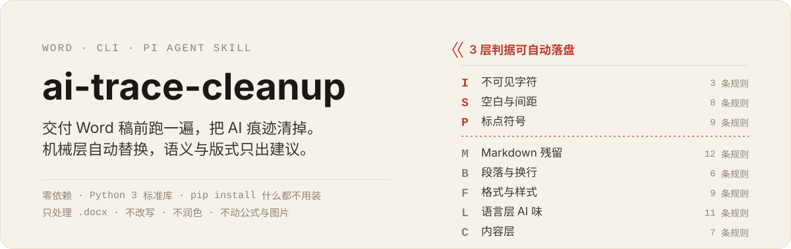
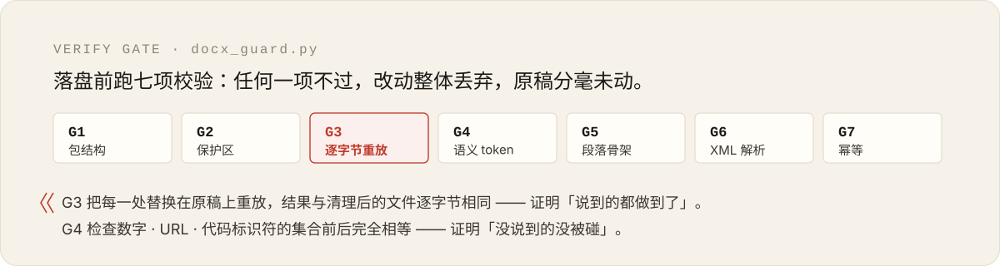

<p align="center">
  
</p>

**交付 Word 稿之前跑一遍，把「一眼看出是 AI 写的」痕迹清掉。**
空格、标点、不可见字符自动替换并逐字节校验；Markdown 残留、版式与措辞只出建议，绝不替你改。

Audit and clean AI fingerprints in Chinese Word (`.docx`) documents before delivery — the mechanical layer
(spaces, punctuation, invisible characters) is fixed automatically and byte-verified, while everything else
is reported for a human to decide and is never silently rewritten.

<p>
  
  
  
  
</p>

---

## 先看真实输出

对仓库自带的回归样本（`tests/sample-dirty.docx`，一份故意写脏的 94 段中文件）：

```console
$ python scripts/docx_scan.py tests/sample-dirty.docx --all

文件：tests/sample-dirty.docx
范围：94 段 / 2205 字 / 24 个语义 token
命中：⛔55  ⚠️78  💡32   （其中可自动修复 53）
  [I] 不可见字符      5
  [S] 空白与间距      59
  [P] 标点符号       20
  [M] Markdown 残留  19
  [B] 段落与换行      15
  [F] 格式与样式      12
  [L] 语言层 AI 味    24
  [C] 内容层         11
报告：tests/sample-dirty.docx.ai-trace/report.md
```

报告里每一条都指到具体段落与具体字符，命中处用 `« »` 框住，看不见的字符换成名字
（节选自它生成的 `report.md`）：

```text
- ⛔ **I01** `document.xml` §p0025 · 零宽字符«ZWSP»夹在中间，不断行空格 也…
- ⛔ **I01** `document.xml` §p0026 · 全角空格　混入，软连字符«SHY»
- ⚠️ **I02** `document.xml` §p0025 · …符夹在中间，不断行空格«NBSP»也来了
- ⛔ **M01** `document.xml` §p0004 · «**重点**»：以下为问题清单说明
  - 改为 Word 加粗格式（选中文字 → Ctrl+B），不要留字面 **
- ⛔ **M03** `document.xml` §p0005 · «## 二»、主要问题
- ⛔ **C02** `document.xml` §p0054 · «以上是我为你»整理的内容，希望对你有帮…
- ⛔ **C06** `document.xml` §p0056 · 本节内容待补充：«[待补充]»
```

**中文里两个汉字之间凭空多出一个空格** —— 这一条最能单独证明稿子是从 Markdown 或对话窗口粘过来的
（人写中文不会在汉字中间敲空格；Markdown 折行渲染后粘进 Word 才会这样）：

```text
- ⚠️ **S08** `document.xml` §p0003 · 本次巡检共« »发现 3 个问题，已闭环…
- ⚠️ **S08** `document.xml` §p0022 · 括号(半角) 和« »全角（混用）
- ⚠️ **S08** `document.xml` §p0089 · 目录项示例：第一章« »概述\t3   ← 落在域结果里，只报告、不自动改
```

清理是逐字符替换，全程只动字符、不碰版式：

```console
$ python scripts/docx_apply.py tests/sample-dirty.docx --out tests/clean.docx --apply

待替换 57 处，共 2 轮：I01×2、I02×1、I03×2、P01×3、P03×2、P05×2、P07×3、S01×27、S03×5、S05×2、S06×2、S07×1、S08×5
✅ 已写入 tests/clean.docx（替换 57 处）
   替换清单：tests/clean.docx.applied.json
   ✅ G1/G2/G6 包结构、保护区、可解析性（5 个非文本部件逐字节未变）
   ✅ G3 逐字节重放（57 处替换）
   ✅ G4 语义 token 集合
   ✅ G5 段落/run 骨架
   ✅ G7 幂等（清理后再扫，0 处机械层残留）
   ✅ 总结：全部通过
```

以上都是复制的真实输出。清理后：`共 3 个问题` 变成 `共3个问题`、`１２３` 变成 `123`、`50 ％` 变成 `50％`、
`...` 变成 `……`；而 `JIRA-1234`、`https://example.com/report?id=9`、`10 kg`、`10-20` 这些**一个字符都没动**。

## 为什么不是「让 AI 改得像人写的」

去 AI 味这件事，市面上常见的做法是**再让一次模型替你重写一遍**。那条路有三个问题：
它会改掉你的数字，会把你原来的措辞换成另一种腔调，而且改完你没法验证它到底动了什么。

这个工具走的是相反的路：**能机器判的，用代码改，并证明只改了这些；不能机器判的，指给你看，你自己动手。**

| | 做法 |
| --- | --- |
| 机械层（空格 · 标点 · 不可见字符） | 脚本改，**改完逐字节证明**「除了这 N 处，文档里什么都没变」 |
| Markdown 残留（`**粗体**`、`##`、`- `、`[文字](url)`） | 只指出位置 —— 转成 Word 原生格式是排版动作，脚本盲改会做出半加粗的碎片 |
| 段落 · 格式 · 措辞 · 内容 | 只出建议 —— 合并哪些段、统一到哪个字体、删不删那句「综上所述」，只有你能决定 |

## 八个层，三层可以自动

下面是仓库里真实的规则分布（共 65 条）：

| 层 | 名称 | 规则 | 管什么 | 处置 |
| --- | --- | ---: | --- | --- |
| **I** | 不可见字符 | 3 | 零宽字符、`NBSP`、软连字符、全角空格混入 | ✅ 自动 |
| **S** | 空白与间距 | 8 | `共 3 个`、`（ 说明 ）`、`50 %`、汉字之间的空格 | ✅ 自动 |
| **P** | 标点符号 | 9 | 中文里的 `,` `;` `:`、直引号、`...`、`--`、`！！` | ✅ 自动 |
| **M** | Markdown 残留 | 12 | 字面 `**粗体**`、`##`、`- `、`[文字](url)`、HTML 实体 | 💡 建议 |
| **B** | 段落与换行 | 6 | 一句话一段、空段落凑间距、空格伪缩进、缺终结标点 | 💡 建议 |
| **F** | 格式与样式 | 9 | 字号漂移、Calibri 混入宋体、加粗率 >15%、手工标题 | 💡 建议 |
| **L** | 语言层 AI 味 | 11 | 首先/其次/最后、综上所述、不是…而是…、赋能/闭环/颗粒度 | 💡 建议 |
| **C** | 内容层 | 7 | 作为 AI、希望对你有帮助、空壳总结段、重复句、占位符 | 💡 建议 |

三层自动里，**默认只落盘 13 条规则**（`I01–I03`、`S01`、`S03`、`S05–S08`、`P01`、`P03`、`P05`、`P07`）。
另外 7 条误伤风险偏高（`S02` 中英之间的空格、`S04` 连续空格、`P02` 直引号、`P04` 破折号、`P06` 半角括号、`P08` 全角符号、`P09` 全角波浪号）
必须用 `--rules` 显式点名才会动 —— 宁可多一步，也不猜你想要哪种排版取向。

## 它怎么证明自己没弄坏你的文件

改 `.docx` 最怕的不是改错，是**没法证明自己没改到别的地方**。所以每次落盘前自动跑七道校验，
任何一道不过，改动整体丢弃、原稿分毫未动：

<p align="center">
  
</p>

| | 检查 | 证明什么 |
| --- | --- | --- |
| **G1** | 包结构不变 | zip 条目名与顺序未变 |
| **G2** | 非文本部件逐字节不变 | 样式表、关系表、主题、图片、`[Content_Types].xml` 一个字节都没动 |
| **G3** | **逐字节重放** | 把每一处替换在**原稿**上重放，结果与清理后的文件逐字节相同 → 「说到的都做到了」 |
| **G4** | **语义 token 集合不变** | 数字、URL、拉丁词、代码标识符集合前后完全相等 → 「没说到的没被碰」 |
| **G5** | 段落 / run 骨架不变 | 段落数与每段 run 数一一对应，段落样式与 `pPr` 原文相同 |
| **G6** | XML 可解析 | 不会让 Word 弹出「发现无法读取的内容，是否修复」 |
| **G7** | 幂等 | 清理后再扫一遍，机械层零残留 |

技术上它**不用 XML 解析器重新序列化整个文档** —— 那会重写命名空间前缀、丢掉 `standalone`、改变属性顺序，
而且一旦重新序列化，「除了我改的地方文档没变」这句话就再也无法证明。
它只在 XML 字节流上定位 `<w:t>` 的边界、替换边界内的字节（必要时补一个 `xml:space="preserve"`），
并把「段落字符坐标」映射回具体的 `run` —— 因为 Word 会把 `共 3 个` 这种句子按格式和编辑历史切成任意多段，
那个空格很可能**独自占一个 run**，不建映射就永远删不掉它。

## 快速开始

零依赖，只用 Python 3 标准库（`zipfile` / `re` / `unicodedata`）：

```bash
git clone https://github.com/drydraft/ai-trace-cleanup.git
cd ai-trace-cleanup
python scripts/docx_scan.py "你的稿件.docx" --all      # 只读审计，不改文件
```

`.doc` 老格式请先在 Word 里另存为 `.docx`。

## 三个命令

```bash
# 1) 审计（只读）—— 默认只跑 I/S/P 三层，--all 连 M/B/F/L/C 一起扫
python scripts/docx_scan.py "稿件.docx" --all --out ./
#    报告写到 稿件.docx.ai-trace/report.md（人读）与 report.json（机读）

# 2) 预览要改什么（默认 dry-run，不写文件）
python scripts/docx_apply.py "稿件.docx" --out "稿件.clean.docx"

# 3) 落盘（自动备份 .bak + 自动跑七项校验，不过就丢弃）
python scripts/docx_apply.py "稿件.docx" --apply

# 4) 单独复核任意两个版本
python scripts/docx_guard.py "原稿.docx" "清理后.docx" --applied "清理后.docx.applied.json"
```

常用参数：

| 参数 | 作用 |
| --- | --- |
| `--preset word-cn` | 默认：全角标点、中英之间不留空格（办公/公文/飞书） |
| `--preset word-cn-loose` | 保守：只清标点与不可见字符，中英之间的空格保留 |
| `--preset word-tech` | 技术文档：中英之间**保留**空格（盘古之白），标点仍按中文规范 |
| `--layers ISP` / `--all` | 只跑机械层 / 八层全跑 |
| `--rules P01,P03` | 只应用这几条规则（`NO_AUTO` 名单里的规则必须这样点名） |
| `--no-headers` | 跳过页眉页脚 |
| `--include-comments` | 连批注一起扫（默认不碰，那是审阅者的话） |

退出码：`0` 无命中 ｜ `1` 仅建议 ｜ `2` 有警告 ｜ `3` 有硬阻或校验失败 ｜ `10` 参数错。

## 规则目录

65 条规则的完整清单（判据、强度、是否默认自动）在
[`references/rule-index.md`](references/rule-index.md)，由代码自动生成：

```bash
python scripts/docx_scan.py --rules-out references/rule-index.md
```

<details>
<summary>行业通病清单里最典型的十二条</summary>

| 痕迹 | 为什么一定是机器留下的 |
| --- | --- |
| 汉字之间的空格（`共 发现`） | 人写中文不会在汉字中间敲空格；Markdown 折行渲染后粘进 Word 才会这样 |
| 零宽字符 / 不换行空格 | 只能来自网页或对话窗口的复制粘贴 |
| `**粗体**`、`##`、`- ` 字面出现 | Markdown 语法直接进 Word，符号变成了可见文本 |
| 一句话一段（连续 ≥5 个 ≤25 字短段） | AI 输出的排版节奏；中文正文通常按意思合并成段 |
| 字号漂移（正文出现 >2 种字号） | 人写一份文档只有 2–3 级字号，多出来的那个是「从别处粘来的」 |
| 同段混用字体 / 正文出现 Calibri | 网页和别的软件的默认字体混进了中文文档 |
| 加粗率 >15% | AI 把「重要」理解成「要加粗」；人写文档加粗量通常不到 5% |
| 「加粗 + 大字号」的手工标题 | 没用 Heading 样式：生成不了目录、导航窗格看不见、统一改字号会漏掉它 |
| 只设 `w:ascii` 不设 `w:eastAsia` | 换台机器中文就变字体 —— 在别的软件里生成的指纹 |
| 首先/其次/最后、综上所述、值得注意的是 | 删掉句子照样成立，只提供节奏不提供信息 |
| 不是…而是…、不仅…而且…、三项排比 | 对举与递进是 AI 的标志性节奏 |
| 作为 AI、希望对你有帮助、以上仅供参考 | 对话客套与免责声明跑进了交付文档 |

</details>

## 实测

仓库自带两道回归闸门，改规则之后必须跑：

```bash
python tests/selftest.py         # 黄金样本回归 + 全链路 + 幂等 + 保护区
python tests/word_roundtrip.py   # 用真 Microsoft Word 做往返验证（需装 Word）
# Windows 上一键跑两个：
powershell -File tests/run-all.ps1
```

- `tests/make_sample.py` 生成一份「AI 痕迹大全」脏样本，**65 条规则必须条条有样本命中** ——
  加了一条规则却没加样本，自检直接失败。这是防止规则悄悄失效的唯一可靠办法。
- `tests/word_roundtrip.py` 用 Word COM 生成一份**真 `.docx`**（十余个部件、真样式表和关系表），
  跑完清理后**再用 Word 把文件读回来比对文本** —— 这是「Word 打得开、没触发修复」的唯一可靠证据。
  手工拼的最小 docx 证明不了这一点。

最近一次结果：`selftest` 65 条规则全覆盖、165 处命中、53 处自动替换全部通过；
真 Word 往返中 11 个部件里的 10 个受保护部件逐字节未变，Word 读回的文本与预期逐字相符。

## 只做什么 / 不做什么

| 做 | 不做 |
| --- | --- |
| `.docx` 的交付前体检与字符级清理 | `.md` / `.txt` / `.rtf`、PPTX、XLSX、PDF |
| 只删字符、不增删句子 | 改写、润色、扩写、翻译、把文风改成「更像人写的」 |
| 在 Word 里提出具体改法（哪个样式、哪个编号） | 代你在 Word 里改版式（Markdown 残留那 12 条永远只出建议） |
| 逐字节证明「只改了这些」 | 绕过校验、放宽校验、或者为了让报告好看而少报 |
| 页眉页脚、脚注、文本框里的段落 | 域结果（目录/页码）、修订痕迹、批注、公式、图片 |

`M/B/F/L/C` 五层的规则在代码里 `auto` 恒为 `false`，不是配置项 —— 想让它落盘必须改代码。

## 作为 Pi Agent Skill 使用

这个仓库同时是一个 [Pi Agent](https://github.com/badlogic/pi-mono) skill。
把整个目录放进 `~/.pi/agent/skills/` 即可，入口是 [`SKILL.md`](SKILL.md)：

```text
SKILL.md                  边界 · 五条铁律 · 导航表 · 核查规范要点
workflows/audit-workflow.md   审计 5 阶段（只读）
workflows/apply-workflow.md   清理 5 阶段（含校验门与回滚）
references/taxonomy.md        ★ 八层逐条判据 / 反例 / 误伤风险
references/verification.md    ★ G1–G7 校验门与不变量清单
references/docx-protection.md 保护区：哪些字节绝对不能碰
references/report-format.md   报告契约与退出码
scripts/                      三个 CLI + 共享层 + 规则核
assets/lexicon-zh.txt         中文 AI 味词表（可直接加词）
docs/MAINTENANCE.md           维护说明、设计取舍、加规则的步骤
```

CLI 部分与 skill 部分互不依赖：只用命令行也能跑，只用 skill 也能跑。
维护说明、设计取舍、加规则的步骤见 [`docs/MAINTENANCE.md`](docs/MAINTENANCE.md)。

## 许可证

[MIT](LICENSE)
